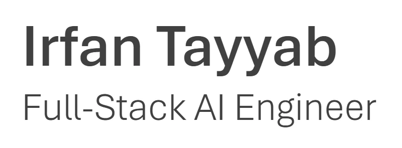
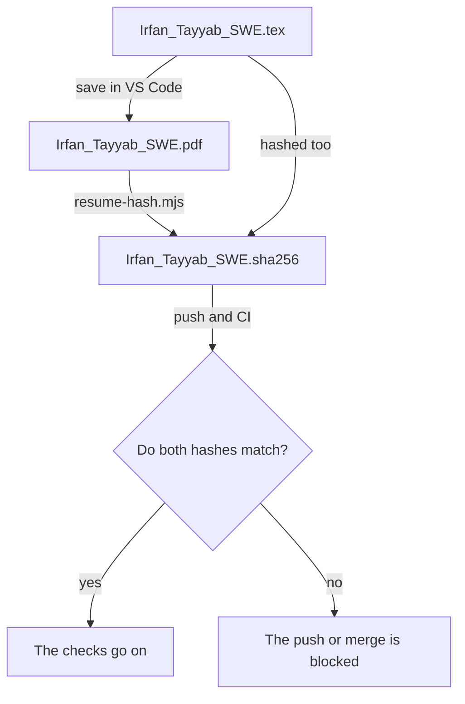

A portfolio and a resume describe the same person, so they must never disagree. The resume is what a recruiter reads first, and the moment the two differ, the portfolio is the one that looks careless: a job title spelled differently, a date a month off, a link that moved. Small things, but each might cost a little trust.

I could keep the two matching by hand, but I might forget. So this site is built on one principle: **if the portfolio and the resume disagree, the site's build fails**, and nothing goes live until they agree again.

## One place for every claim

Everything the site repeats from the resume lives in one TypeScript file, `claims.ts`: my name and headline, my email, my LinkedIn, GitHub and website addresses, and each job and degree with its dates. I call these **the claims**. The site's pages are built from that file.

So I edit two files, the resume and `claims.ts` (AI helps), and it does not matter which one changes first. What matters is that every claim in one matches the other letter for letter.

Having one file does not make it match the resume. It only gives the checks one place to look.

## A test that reads the LaTeX

The resume is written in LaTeX: a plain-text file, `Irfan_Tayyab_SWE.tex`, which a program called XeLaTeX turns into the PDF. From here on I call that file **the source**, since the PDF is built from it. It sits in the same repository as the site.

A test reads the source itself, picks out every claim in it, and compares each with `claims.ts`, one by one, in the same order. It checks in both directions: a job on the resume that the site lacks fails it, and so does a job on the site that the resume no longer has.



The tests run on my PC before every push, and again on every pull request in CI, the build server, where nothing merges until they pass. So a claim on the site can only change in the same commit as the resume.

## The PDF is checked too

The source is not what people read. They read the PDF. So a second test pulls the text out of the committed PDF and looks for every claim from `claims.ts` in it, each one whole and in order.

That still leaves a gap. CI cannot build the PDF: it uses Microsoft's Aptos fonts, which are licensed with Office and cannot be installed on a build server. So I build it on my own PC and commit it beside its source. If I edit the source and forget to rebuild, the PDF goes stale. When the edit changes a claim, the two tests above catch it. When it changes a **bullet**, one of the lines under a job describing what I did there, nothing so far would notice. That gap needed one more check: one that ties the PDF to its source.

## Tying the PDF to its source

The resume builds in VS Code, through LaTeX Workshop, the extension that runs XeLaTeX each time I save. Each build of the resume ends with a small script that takes a SHA-256 hash of the source and of the PDF, and saves both in a small file of their own, `Irfan_Tayyab_SWE.sha256`, committed beside them. A hash is a **fingerprint** of a file: change a single byte, and it changes. A third test, run before every push and again in CI, takes fresh fingerprints of the source and the PDF, and compares them with the two saved in `Irfan_Tayyab_SWE.sha256`. If either differs, the test fails. It means the source or the PDF changed after the last build.



LaTeX Workshop runs the script after every build, failed ones included, so the script has to tell a good build from a bad one itself. Before saving the fingerprints, it compares the times the files were last written. XeLaTeX rewrites its log on every run, and writes the PDF after it only when the build succeeds. So a log older than the source means no build ran since the last save, and a PDF older than the log means that build failed. Either way, it saves no fingerprints. These are the two checks, in bold:

```js title="scripts/resume-hash.mjs" {1,4}
if (statSync(log).mtimeMs < statSync(tex).mtimeMs) {
  skip(`XeLaTeX did not run on ${basename(tex)} since it was saved`);
}
if (statSync(pdf).mtimeMs < statSync(log).mtimeMs) {
  skip(`${basename(pdf)} was not written by this build, which failed`);
}
```

One nuance needed handling too. A PDF normally stamps the time it was made inside itself, so running a build without any change to the source would still produce a new PDF, with a new fingerprint, to commit. The resume's build pins that time, so an unchanged source always builds the identical PDF.

## All six checks

The site, a Next.js static export, builds its pages from `claims.ts` and serves the resume as a file at a URL of its own. That makes six checks, each watching a different pair that could drift apart: the source and `claims.ts`, the PDF and `claims.ts`, the PDF and its source, the pages and `claims.ts`, the file served and the file committed. The hash script runs on my PC after every build of the resume; the rest run before every push, and again in CI:

1. **The claims test** catches a job, a date or a link changed on one side only.
2. **The PDF text check** catches a PDF that says something different from `claims.ts`.
3. **The hash script** saves fingerprints only after checking that the PDF was just written by a build that succeeded, so a failed build is never recorded.
4. **The hash check** fails when the source or the PDF changed since the hash script last ran, so an edit without a rebuild, bullets included, cannot pass until I rebuild.
5. **The page check** reads the text of the built pages (not how they look) and catches a claim that is missing or misspelled there, a bug in the page itself that the tests on `claims.ts` cannot see.
6. **The download check** compares the resume the site serves with the committed PDF, byte for byte, so visitors download exactly the PDF the other checks passed.

> [!TIP]
> Keeping the shared facts in one file, and failing the build when another document disagrees with it, works for any two documents that must agree, not only a portfolio and a resume: a product page and its price list, say.

None of it is clever. It is six small checks that turn "I'll remember to update both" into a build that will not pass until I do. All of it is in the site's public repository, [irfantayyab/irfantayyab](https://github.com/irfantayyab/irfantayyab), for anyone who wants to read the code itself.
