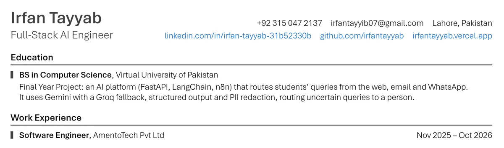
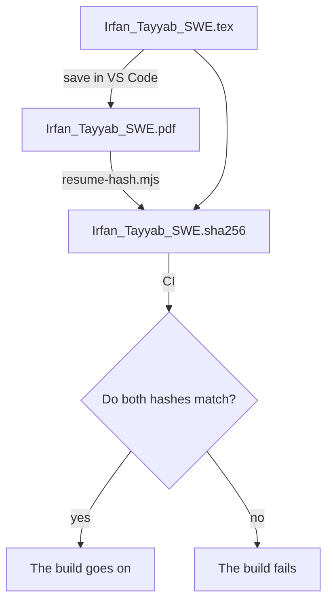

A portfolio and a resume tell the same story twice. The resume is the one a recruiter reads first, so the moment the two disagree, the portfolio is the one that looks careless. A job title spelled differently, a date a month off, a link that moved: small things, and each one costs a little trust.

I could promise to keep them in step by hand. I would forget. So this site checks itself instead.

## One place for every claim

Everything the site says that the resume also says lives in one TypeScript module: my name, my headline, each job's title, organisation and dates, and the contact links. Pages read those claims from there and nowhere else. A job title is never typed into a page.

That alone does not keep anything true. It only means there is one place to check.

## A test that reads the LaTeX

The resume is a LaTeX file in the same repository as the site. An integration test reads it, finds every job entry and the header's links, and compares them with the module, in order and both ways. A job added to the resume but not to the site fails the test, and so does one removed from only one side.



A claim on the site can only change in the same commit as the resume, or the build goes red.

## The PDF is checked too

The LaTeX source is not what people read. They read the PDF. So the same test extracts the text of the committed PDF and looks for every claim in it, each one whole and in order.

That still leaves a gap. CI cannot build the PDF, because the fonts it uses come with Microsoft Office and cannot go onto a build machine. I build it on my own PC and commit it beside its source. If I edit the source and forget to rebuild, the PDF goes stale, and if the change was a bullet rather than a claim, the text check never notices.

## Tying the PDF to its source

Each build in VS Code ends with a small script that writes the SHA-256 of the LaTeX source and of the PDF into a file committed with them. The test recomputes both hashes, and fails if either file changed without a build.



The script is careful about which builds count. It writes the hashes only when the build that just ran produced the PDF: the build's log must be newer than the source, and the PDF newer than the log. A failed build, or a PDF that Git swapped in during a rebase, is never recorded against a source it was not built from.

```js
if (statSync(log).mtimeMs < statSync(tex).mtimeMs) {
  skip(`XeLaTeX did not run on ${basename(tex)} since it was saved`);
}
if (statSync(pdf).mtimeMs < statSync(log).mtimeMs) {
  skip(`${basename(pdf)} was not written by this build, which failed`);
}
```

> [!NOTE]
> LaTeX Workshop runs the next step of a recipe even when the build fails, which is why the script checks the times itself instead of trusting that it ran after a good build.

For that to work, the same source has to build the same PDF every time. The build pins the PDF's creation date, so saving without a change leaves the PDF and its hash exactly as they were.

## What it buys

The resume is served by the site at a URL of its own, and a browser test checks that the file served is byte for byte the one committed. Between that, the claims test and the hash, the site cannot quietly drift from the resume, and the resume cannot quietly drift from its own PDF.

None of it is clever. It is three small checks that turn "I'll remember to update both" into a build that will not pass until I do.
